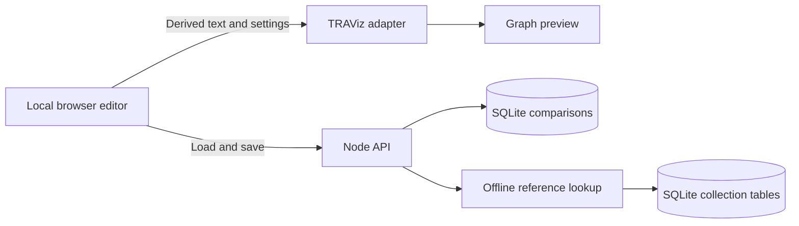

# TRAViz parallel text app plan

Status: first implementation on `feat/parallel-text-app`, 2026-10-02.

Build a local research workspace where one user can enter or look up passages,
arrange their textual parallels, preview TRAViz alignments, and reopen the work
from a backend database. Existing examples remain available throughout the work.

## Implementation progress

- Repository instructions and three workflow skills are committed.
- The React/Vite app, Fastify API, numbered SQLite migrations, and source-based
  TRAViz asset build are implemented in `app/`.
- The initial workflow supports manual row/whole-passage entry, reviewed line
  splitting with original snapshots, source/row ordering, RTL/settings controls,
  a selected-row preview, and create/read/update/delete with revision checks.
- Database restart fidelity, transaction rollback, schema validation, stale writes,
  and splitting are covered by automated tests. Browser checks exercise the
  production assets and editor flows; commands are in [app setup](../app/README.md).
- Remaining: offline corpus installation/lookup, full legacy import, JSON
  interchange, duplication, richer library search/pagination, backup tooling,
  row regrouping/recombination, and broader performance/accessibility verification.

Verified for this first slice: production build/typecheck, four database/API/model
tests, and three Chromium browser workflows pass. Browser coverage includes
save/reopen, stale-tab conflicts, failed-save draft retention, line splitting,
Hebrew/Greek/English fixtures, literal markup in tokens/tooltips, and narrow layout.

Implementation decisions: use Node 24's built-in SQLite driver; normalized tables
for comparisons/sources/rows/cells; isolated preview frames with a plain-text engine
mode; deterministic app asset generation rather than the legacy append-based Rake
compression task. Hover highlights now move behind existing text instead of
reparenting the hovered text node, preserving native tooltip clicks. The initial
preview displays one chosen row and limits it to
600 words across visible sources. Search currently filters the latest 200 titles;
the richer library/API search remains planned.

## Confirmed requirements

- One user, running locally.
- React and TypeScript for the interface, a Node backend, and SQLite storage.
- Both a row editor and whole-passage entry in the first version.
- Whole passages can be compared immediately, then optionally split at line
  breaks and manually adjusted into corresponding rows.
- Offline Bible passage lookup from a local collection, starting with Hebrew
  Bible, Greek New Testament, and Septuagint texts.
- Recommend suitable editions for those collections.
- The existing `test/` examples guide the comparison and visualization behavior.

## Proposed defaults and remaining decisions

| Decision | Proposed default |
| --- | --- |
| UI/build/server tools within the chosen stack | Vite and Fastify; select compatible versions when scaffolding. |
| Initial editions | WLC through Open Scriptures, SBLGNT, and Rahlfs 1935 LXX; source details below. These are recommendations, not user-selected exact editions. |
| Saving | Explicit Save, a dirty indicator, and unsaved-navigation protection first. Autosave can follow. |
| Import scope | Existing Bible datasets first, including Hebrew, Greek, and English examples. Other demo formats later. |
| Word-level graph corrections | Defer persistent merge/split edits; row grouping remains editable. |
| Scale | Start with comparisons of roughly 2–12 sources and tens of rows; measure long examples before fixing limits. This is a planning target, not a measured capacity. |

No unanswered question prevents this plan from guiding initial implementation.
Exact corpus snapshots, importer details, and the LXX distribution terms need
verification during the collection milestone. Do not silently substitute an edition
for a differently labeled one in an existing example.

## Interface and workflow

### Comparison library

Show saved comparisons with title, source labels, language, tags, and last modified
time. Offer New, Open, Duplicate, Delete, Import, and Export. Start with title,
label, reference, and tag search; defer sophisticated full-text search. Confirm
deletion in the app and keep failed operations visible.

### Comparison workspace

Provide title and notes, source controls, the passage editor, and a preview tab or
adjacent pane. Sources have a label, optional edition/reference, language, direction,
and color. Source ordering and row ordering are explicit and persisted.

1. Add source columns; support two or more for comparison and partially filled drafts.
2. Choose manual row entry, whole-passage entry, or lookup from the local collection.
3. Edit text and per-cell references, add/remove/reorder rows, and mark gaps as
   missing. Preserve intentionally empty text as a distinct state.
4. Preview each row or the initial whole-passage block. Toggle sources, select the
   main branch, and adjust supported visualization settings.
5. Save. Show unsaved, saving, saved, or failed status based on the server response.
6. Reopen the comparison after a browser refresh or backend restart.

Whole-passage entry initially produces one row with one text block per source. An
optional split wizard previews line-break segments, preserves empty lines, and
allows the user to group/split/move cells before applying. Line position is only an
initial suggestion of correspondence. Keep the original pasted input as an
immutable entry snapshot and record line separators if offering exact recombination.
After applying, the row document is the editable source of truth; do not maintain
two independently editable copies that silently diverge. A later whole-passage
replacement must preview the affected cells before changing existing rows.

Keep app navigation left-to-right while supporting source/cell direction and graph
RTL explicitly. Preserve Hebrew marks, Greek accents, whitespace, and punctuation.
Use readable font fallbacks and verify glyph coverage; the legacy `SBL BibLit`
declaration is not a bundled font. Support keyboard row/source operations and useful
horizontal scrolling or source-focused editing on narrow screens.

### Offline passage lookup

Select a collection/edition and enter a book, chapter, verse, or range. Show the
resolved reference, exact text, and provenance before inserting it into a source
or selected cells. Offer one block or verse-based initial rows, with a preview of
how those rows will be grouped. Verse matching across editions is not guaranteed.

Use each collection's canonical book IDs, aliases, ordering, and versification.
Support LXX/MT numbering differences and partial verse labels without silently
converting references. Report missing or ambiguous references and incomplete
ranges. Insert an editable text snapshot with edition, reference, collection
version, and provenance; subsequent corpus changes must not rewrite saved work.
Manual entry remains available without an installed collection. After collection
installation, startup, editing, lookup, and graph rendering must work without a
network connection; serve application assets locally too.

## Recommended starting collections

These are practical starting editions for this app, not claims that they reproduce
every edition represented in the fixtures. Preserve existing imported labels/text.

| Collection | Recommended source | Integration notes |
| --- | --- | --- |
| Hebrew Bible | [Westminster Leningrad Codex through Open Scriptures Hebrew Bible](https://github.com/openscriptures/morphhb) | OSIS XML in `wlc/`; retain Hebrew marks and original numbering. The project identifies WLC text as public domain and its lemma/morphology data as CC BY 4.0. |
| Greek New Testament | [SBL Greek New Testament from Faithlife](https://github.com/Faithlife/SBLGNT) | Publisher-maintained source files under CC BY 4.0. Keep its edition identity explicit; it is not NA27 or Textus Receptus. |
| Septuagint | [Rahlfs 1935 dataset maintained by Eliran Wong](https://github.com/eliranwong/LXX-Rahlfs-1935) | Provides accented Unicode data and versification material. Its stated license is CC BY-NC-SA 4.0 and the README also flags upstream CCAT restrictions. Inspect the exact selected files and accompanying terms before packaging a collection; do not label the dataset unrestricted or public domain. |

Keep edition metadata, attribution, upstream URL, pinned revision, and file checksums
in an import manifest. Initially import text and reference structure; morphology,
lexicons, and glosses are outside the first version. For Hebrew, explicitly handle
qere/ketiv and markup separators instead of concatenating every XML text node.
For LXX, retain book variants and edition-specific references. Define reconstruction
of spaces and punctuation per source format, preserve original source artifacts,
and test a sample against the upstream presentation before importing all books.

The collection importer may read previously downloaded files; obtaining the initial
files is separate from runtime lookup. Include complete installation instructions
and a completeness report, so “offline” does not depend on a hidden online API.

## Architecture

Layout introduced by the first implementation (collection scripts remain planned):

```text
app/
  src/client/          React library, editor, lookup, and graph adapter
  src/server/          Node HTTP API, repositories, collection access
  src/shared/          Validation and versioned document contracts
  migrations/         Ordered SQLite migrations
  scripts/            Fixture and collection import commands
  tests/              Unit, database integration, and browser checks
  data/               Local SQLite files and corpus sources, ignored by Git
  backups/            Local backups, ignored by Git
```

Use one application package and one SQLite database initially. Proposed Vite
development proxy forwards `/api` to the backend; the production backend serves
the built client and API from one origin. Bind to `127.0.0.1` for local mode.
Validate Host/Origin and JSON writes without broad cross-origin access. Accounts,
cloud services, and public deployment are outside this version.



TRAViz runs in the browser behind a mount/update/dispose adapter. SQLite stores the
authored comparison, not SVG or renderer vertex objects. Keep the renderer out of
server imports. Retain the legacy demo tree and URLs; load legacy dependencies once
in a dedicated integration boundary. Do not add a second modern jQuery dependency
simply to satisfy old globals.

## Proposed persistent model

| Entity | Main fields and purpose |
| --- | --- |
| Comparison | Stable ID, title, notes, tags, revision, timestamps, validated visualization settings. |
| Source | Stable ID, comparison ID, position, label, short label, language, direction, optional edition/reference metadata, color. |
| Parallel row | Stable ID, comparison ID, position, optional label and notes. |
| Cell | Comparison/row/source identity, exact text or missing state, optional reference and provenance. |
| Entry snapshot | Original pasted or imported input and provenance; immutable and separate from edited cells. |
| Collection | Stable ID, edition identifier/title, language, version, versification, source and attribution metadata. |
| Collection passage | Collection ID, book ID, chapter, verse/part label, canonical order, exact text, original reference. |

Use a cell record for each row/source pair, with nullable text representing missing
and `""` representing explicitly empty. A draft can have missing cells. Require
stable IDs, unique positions per comparison, foreign-key integrity, and consistent
comparison membership across every row, source, and cell. Enforce constraints in
the database where practical and validate the complete document before a write.

Save the document atomically with a revision precondition. Reject stale writes with
a conflict response; keep the local draft available. Increment the revision only
after the full transaction commits. Generate new identities when duplicating a
comparison and remap references consistently. Persist selected source IDs, main
branch, normalization mode, graph direction, and supported settings with defaults
that tolerate later source removal.

Use explicit schema migrations. Keep databases out of Git. Provide a supported
SQLite backup/restore flow; do not copy only a live main database file while
ignoring possible journal state. JSON exports provide interchange, not a backup
of the full database and collection metadata.

## Proposed API boundary

| Endpoint | Behavior |
| --- | --- |
| `GET /api/parallels?q=...` | Search/list comparisons with pagination. |
| `POST /api/parallels` | Validate and create a complete or draft comparison. |
| `GET /api/parallels/:id` | Return the document and revision. |
| `PUT /api/parallels/:id` | Atomically save with `expectedRevision`; return the saved document/revision. |
| `DELETE /api/parallels/:id` | Delete with a revision precondition. |
| `POST /api/parallels/:id/duplicate` | Create a copy with remapped IDs. |
| `GET /api/parallels/:id/export` | Download versioned JSON. |
| `POST /api/import/preview` | Validate a supported format and return a preview/report. |
| `POST /api/import` | Revalidate and save an accepted import transactionally. |
| `GET /api/collections` | List installed editions, versions, and coverage. |
| `GET /api/collections/:id/passages?reference=...` | Resolve a reference/range locally; return exact text and provenance. |

Return field-specific validation errors, not-found errors, and revision conflicts.
Bound input sizes based on measured renderer behavior. No endpoint accepts executable
JavaScript or arbitrary server filesystem paths. Collection installation can start
as a local command; it does not require a general file-management API.

## Legacy import and rendering

Use [existing data notes](EXISTING_DATA.md) as the import specification. Start with
a manifest mapping Bible dataset paths to title, language, viewer, direction, and
settings. Parse literal variable declarations instead of evaluating JavaScript.
Preserve label order, row order, empty strings, absent trailing cells, and embedded
citation prefixes. Provide a report and import fingerprint; repeated imports must
not silently overwrite the user's edits.

The renderer currently parses passage input as HTML, constructs HTML tooltips, and
inserts tokens with `.html()`. Before enabling entered text in previews, handle all
those paths with plain-text semantics and test the assets the app actually uses.
Preserve literal markup as text and verify that labels cannot execute markup.

Make source identity independent of labels and maintain colors when sources are
hidden. Do not pass missing cells blindly to the aligner. For zero non-empty
passages show an empty preview; for one show readable text without a misleading
comparison. Set `splitAndMerge: false` while persistent manual word corrections are
out of scope. Normalization applies only to derived renderer input.

The legacy build appends compressed output. Establish a reproducible source/bundle
build before production use so source fixes reach built assets. Preserve the demos
and upstream attribution while doing so.

## Implementation milestones

Milestones 1 and 2 have an initial implementation. Milestone 3 is partially
implemented; milestones 4–6 remain. The descriptions below define the target scope
and checks, with the current working subset recorded above.

1. **App scaffold and renderer proof.** Add the app package, compatible pinned
   tooling, commands, and adapter. Resolve HTML insertion paths and the asset build.
   Verify Hebrew Psalm 14/53, Greek conversion, and an English example through the
   adapter, including literal markup, empty rows, repeated mounts, and RTL.
2. **Persistence and one complete workflow.** Add migrations, validation,
   transactions, and create/read/update/delete APIs. Build a minimal form that saves
   a comparison and reopens it after backend restart. Verify Unicode fidelity,
   failed-write rollback, and stale revisions.
3. **Full editor and preview.** Add library/search, source/row operations,
   whole-passage entry, split preview, references, missing cells, source toggles,
   and main-branch/settings controls. Verify both entry modes share one document,
   failures retain drafts, and keyboard/mixed-direction use works.
4. **Offline Bible lookup.** Pin corpus snapshots, record source terms, implement
   the importers and local reference index, then edition selection, preview, and
   insertion. Verify Hebrew/Greek text, numbering differences, incomplete ranges,
   provenance snapshots, and lookup with networking disabled. Report collection
   coverage and exact versions.
5. **Existing data and portability.** Add the Bible fixture manifest and
   literal-only importer, JSON export/reimport, duplicate handling, and backup/
   restore. Verify representative fixtures, then all supported Bible datasets
   with explicit skips/errors. Keep original fixture files intact.
6. **Local release checks.** Document install/start, migrations, collection setup,
   and backup/restore. Run browser workflows, database integration checks,
   typecheck, and the production build. Measure long passages and repeated graph
   updates, then document operational limits and any remaining issues.

## Acceptance criteria

- Create a comparison in either entry mode, save it, restart the backend, and
  reopen identical text, references, source/row ordering, and settings.
- Compare whole passages immediately; optionally split and adjust rows without
  losing the original input or confusing missing and empty cells.
- Look up passages in installed Hebrew Bible, Greek NT, and LXX collections with
  networking disabled. Insert/edit a copy while preserving its provenance.
- Import Hebrew, Greek, and English examples and preserve their source/row
  relationships; report malformed or unsupported input before saving.
- Display Hebrew RTL, Greek accents, and mixed labels correctly. Preserve raw
  strings through save/export/reimport; display markup-looking content as text.
- Retain drafts after failed saves, detect conflicting tabs, and avoid partial saves.
- Export/reimport a comparison and restore a database backup successfully.
- Keep existing demo URLs working and document the commands actually shipped.

## Deferred scope

Accounts, collaboration, public publishing, online corpus APIs, automatic discovery
of parallel passages, automatic row matching, persistent manual token corrections,
rich annotation systems, morphology/lexicon tools, and non-Bible demo importers.
TRAViz automatic word alignment within a supplied row is included in the preview.

## Technical references

The stack is user-confirmed; Vite and Fastify are proposed implementations. Pin
versions and verify compatibility during scaffolding.

- [Vite guide](https://vite.dev/guide/) for client development and builds.
- [Fastify documentation](https://fastify.dev/docs/latest/) for the proposed API.
- [SQLite usage guidance](https://www.sqlite.org/whentouse.html) for local storage.
- [Codex project instructions](https://learn.chatgpt.com/docs/agent-configuration/agents-md)
  and [skills](https://learn.chatgpt.com/docs/build-skills) for repository guidance.
